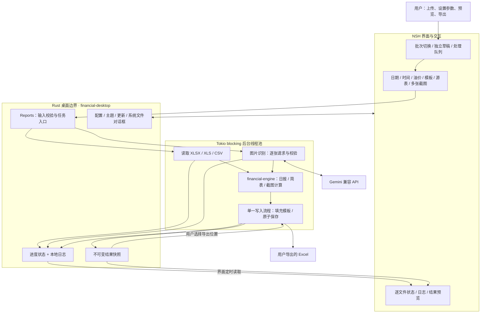
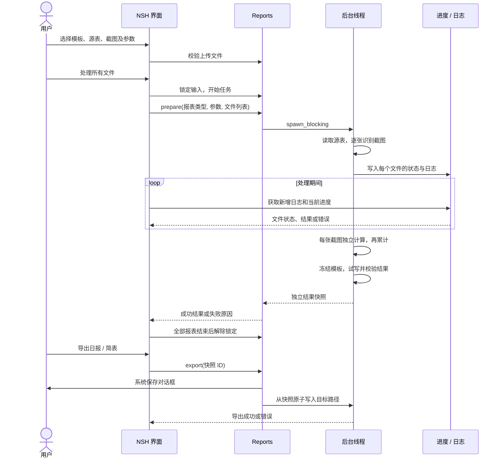

# 原生桌面版架构

本次迁移以 Python / PySide6 版功能为基线：保留模板、日期、上下班时间、油价、源表与多张截图、预览、处理状态、日志、主题、配置和更新功能。运行时采用 NSH + Rust，不启动或捆绑 Python。Python 版仅作为迁移期间的计算对照。

## 总体结构



界面不执行 Excel 读取、图片解码、网络识别或报表写入。`Reports.prepare`、预览、识别、导出和更新网络操作进入 NSH 的 `blocking`，其实现调用 `tokio::task::spawn_blocking`。界面通过 Promise 得到任务结果，通过进度快照得到中间状态。这里没有独立 Python 进程、HTTP 本地服务或消息队列。

## 首页上传布局

首页以“集中上传 → 处理 → 分别导出”为主流程。顶部提供可横向滚动的加油站标签和“添加加油站”，标签可命名为实际加油站名称（内部仍以 Batch 隔离每次填表任务）；切换不清空输入，也不结束后台任务。每个加油站标签带 × 移除入口，内容区不重复放置关闭按钮；移除前确认，移除最后一个站点会补一个空白站点。日期、时间和油价位于顶部；两种输出模板并排，四类源表和八类平台截图按可用宽度排列：源表和截图区域宽度达到 948 点时为四列，468–947 点为两列，更窄时为一列。上传块直接展示文件名或图片数量及处理状态，点击主体选择或替换文件，拖放和粘贴入口保留。

多张截图的逐张预览、移除和状态详情在“管理”中展开；表格处理详情也按需展开，不再在页面底部重复列一遍文件。调价后统计、通联以及简表参数默认收起，展开入口显示已上传数量或已填余额，收起不删除数据。底部固定保留上传数量、所选模板缺少的必填表、处理和导出操作；缺表提示不阻止两种报表各自处理和独立报错。文件与结果预览均按需打开。

## 与原版线程架构的对应关系

| Python / Qt | 原生版 | 职责 |
|---|---|---|
| MainWindow + Qt 控件 | Workstation.tsx + NSH 控件 | 交互、输入与状态展示 |
| TableProcessingWorker / SimpleReportWorker | Reports.prepare → blocking | 读取源表、生成日报或简表 |
| ProcessingWorker | recognition.rs → receipts.rs | 图片识别、字段校验与金额映射 |
| Qt Signal | Promise + Activity 进度快照 | 完成、错误和逐文件状态 |
| ExcelUpdateWorker | workbook.rs 的单一写入流程 | 累计完成后统一修改工作簿 |
| LogViewer + loguru | 日志页 + runtime.rs | 实时日志和本地文件 |
| QSettings / .env | preferences + 兼容 .env 读取 | 主题与识别配置 |
| AppUpdater | updater.rs | 版本检查、下载进度、取消及打开安装包 |

后台线程由线程池管理，不为每个上传文件长期保留一个线程。界面支持处理当前批次时创建并上传另一批次；提交的批次按 FIFO 队列处理，同一批次内仍按报表顺序执行。简表和日报各自捕获失败，一个失败不会抹掉另一个已成功的结果。图片按顺序识别，保留限流间隔与临时失败重试；本次没有增加识别请求并发数。

`batches.ts` 保存每批独立的文件、日期/上下班时间、油价、简表参数、结果和错误。状态依次为待处理、排队中、处理中、可导出/部分完成/失败；排队中可取消并恢复编辑，运行中禁止重置或关闭该批次。提交时复制文件选择与配置到 Job，异步上传、处理和导出的回调始终持有所属 Batch，不根据回调发生时选中的标签决定写入位置。固定加油站列表（稳定编号、名称、油价、顺序、当前选择）通过 `Reports.stations/saveStations` 自动保存到用户数据目录的 `stations.json`，重启后恢复；日期与上下班时间重新初始化，文件选择、期末余额、处理队列、结果等每日数据仅留在本次会话中。写入使用临时文件与原子替换，读取失败时保留原文件并明确提示、禁用自动覆盖，保存失败在界面提示。重置当前站点只清理本次任务，× 移除操作会同步更新固定列表。

Rust `Job`、进度记录、结果快照与粘贴图片均携带批次归属。`begin(batchId)` 只清理该批次的进度，`reset(batchId)` 只释放该批次的快照和临时图片；原始文件不删除。窗口关闭保护检查所有批次的忙碌状态，更新安装也不能与后台处理重叠。已完成批次可以在其他批次处理时预览和导出。

## 一次生成与导出的生命周期



- 同类多张图片保留为列表。逐张按既有规则折算，再累计各单元格，不能先合并原始金额后才统一舍入。
- 工作簿只有一个写入者。后台线程不共享可变 Excel 对象；配置、进度和结果索引使用短时互斥锁。
- 结果持有冻结模板及计算更新。修改输入即废弃旧结果；导出不会重新读取后来被改动的源表。
- 源文件及原模板受覆盖保护；临时文件写完后再落到目标位置。公式、样式、图片和未填写区域尽量按原 ZIP 内容保留。
- 日报“调价前”C68 如已有公式，由模板负责现金充值与公户充值的分配，程序不覆盖；为空或普通数值时仍按源表计算填写。含固定金额的模板公式需要用户按当日数据更新，程序不会改写公式中的常量。
- 处理期间仅锁定所属批次的输入、重置和关闭；其他批次仍可编辑。任一批次忙碌或更新下载时禁止退出应用。NSH 当前没有公开关闭拦截 API，因此通过仓库内小补丁增加 macOS / Windows 关闭保护；bootstrap 自动应用补丁。
- 重置只清理当前批次拥有的临时文件和结果，不删除其他批次数据或用户上传的原件。
- 日期保存完整年月日；现有日报映射取其中的日。上下班时间按原版保留，暂不引入原计算器没有使用的新筛选条件。

## 代码位置

```text
native/
├── app/
│   ├── App.tsx                    # 应用入口
│   ├── Workstation.tsx            # 页面、输入、批次队列、任务状态与交互
│   ├── batches.ts                # 每批独立状态与输入
│   ├── clipboard.ts              # 文件列表优先、截图与文本路径粘贴
│   ├── controls.tsx               # 日历、油价、主题与通用控件
│   ├── Preview.tsx                # 表格与多图预览
│   └── bridge/src/
│       ├── lib.rs                 # Reports 原生接口、任务和快照
│       ├── runtime.rs             # 配置、进度、本地日志
│       ├── preview.rs             # 表格分页和图片预览
│       ├── recognition.rs         # 图片识别服务边界
│       └── updater.rs             # 检查、下载及打开更新包
├── engine/src/
│   ├── source.rs                  # 表头识别、数值和源表校验
│   ├── report.rs                  # 日报、简表计算
│   ├── receipts.rs                # 图片字段映射与多图累计
│   └── workbook.rs                # 保留模板内容并写入指定单元格
└── patches/close-guard.patch       # 固定 NSH 版本的关闭保护扩展
```

## 验证与交付边界

1. 使用用户已核验样表对比 Rust 与 Python 计算结果，并保留负数、赠送、重复表头、缺失字段、多图累计等回归测试。
2. 界面测试覆盖日期、时间、油价、上传、预览、多图、状态、日志、重置、配置、主题和独立导出。
3. 原生窗口与打包应用需要单独验证；核心测试通过不代表界面功能齐全，也不代表 Windows 安装包已验证。
4. 实际在线图片识别和更新安装依赖外部服务 / 对应发布包；本地模拟服务测试与实际服务验收分开记录。

当前已接入计算内核、后台任务、日期与时间、油价、多图、文件预览、日志、进度、主题、配置和更新界面。当前 Rust 回归测试 19 项、headless 界面测试 15 项通过。新增批次测试覆盖处理时上传另一批、日期与油价隔离、取消排队后再次提交、切换后异步粘贴仍归原批次、失败不影响其他批次，以及重置不删除其他批次的输出/进度/粘贴图片。界面时序测试仅在测试入口控制任务放行时间，放行后调用真实 Rust 计算与预览。早期版本曾有 5 项真实 macOS 窗口测试通过；为不干扰用户操作，本次批次与字重改动未运行原生 GUI 自动化。已有源表计算与 Python 对照一致。Windows 打包/安装、真实在线识别及发布后的更新安装尚未进行现场验收。界面只展示业务操作、结果和错误，不展示填写规则或舍入算法说明。

新增的 2026-10-20 真实日报核验曾发现 C68 被覆盖后重复计入 C72“公户充值”。现按用户确认保留 C68 的模板公式：写出文件后，C68 原公式 `=6845.83-7166.67`、C72 金额与 E68 合计公式均保留，其余 17 个自动填写单元格与原表一致（其中 2 个优惠字段由加油明细汇总交叉核验，缺少当天独立优惠源表）。新增回归覆盖公式、旧数值、零值和空白四种 C68 输入；未进行 Excel 原生重算或完整日报凭据验收。原件未修改；完整证据保存在本工作区 `.context/daily20-audit/`，未提交私人样表。

## 组件与工程检查

字重通过 `controls.tsx` 的语义样式集中定义：标题 20/600、分组 14/600、上传名称 14/500、输入 14/400、文件名 13/400、提示 12/400；普通按钮使用 400，主按钮使用 500，日期与油价使用等宽数字。粘贴、预览和移除采用较轻的按钮背景，减少与上传名称竞争。

界面复用固定版本 NSH 的 `nsh/base`（按钮、弹窗和系统确认框等），以 `controls.tsx` 集中管理业务控件及浅色/深色外观。上游基础组件负责交互、焦点和可访问性；官方 Gallery 演示视觉样式，但基础库不附带一套完整的成品视觉组件。上游主题支持 shadcn/tweakcn 的 CSS 变量结构，这不意味着 React/DOM 组件可以直接用于 NSH。

- 官方组件说明：[nsh/base](https://github.com/longbridge/nsh/blob/caaa58ccdcb2529c710219fdd52576bbda84b022/website/modules/nsh-base.md)
- 官方样式参考：[Gallery controls](https://github.com/longbridge/nsh/blob/caaa58ccdcb2529c710219fdd52576bbda84b022/examples/gallery/demos/Controls.tsx)
- TSX：固定 Biome 2.6.2 的独立二进制，下载时及运行前校验 SHA-256；启用推荐规则，使用 NSH 的透明 JSX 模式，不启用 React 专用规则。
- Rust：仅检查本项目两个 crate 的 rustfmt 和 Clippy，Clippy 警告视为错误。
- 类型：`nsh check` 生成 Rust 桥接声明，再执行 TypeScript 类型检查。
- CI：Windows / macOS 构建均执行格式、lint、类型和测试后才打包。工具仅用于开发和 CI，不进入用户安装包。

```sh
./scripts/check-native.sh          # format check + lint + types
./scripts/check-native.sh format   # apply formatting
```

Windows 对应 `./scripts/check-native.ps1` 和 `./scripts/check-native.ps1 format`。
